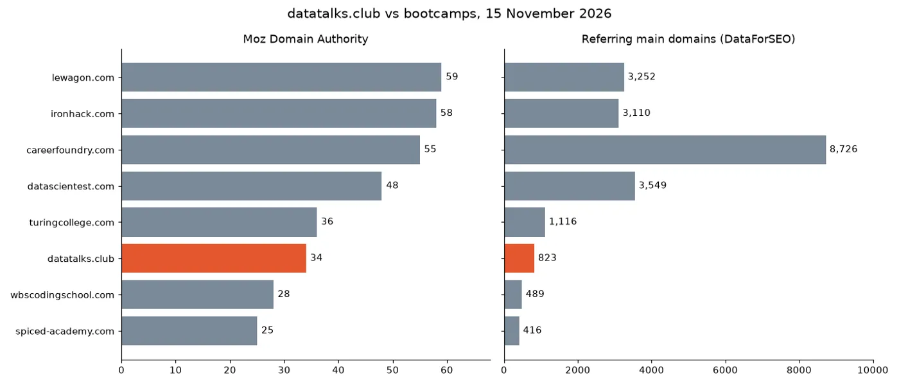
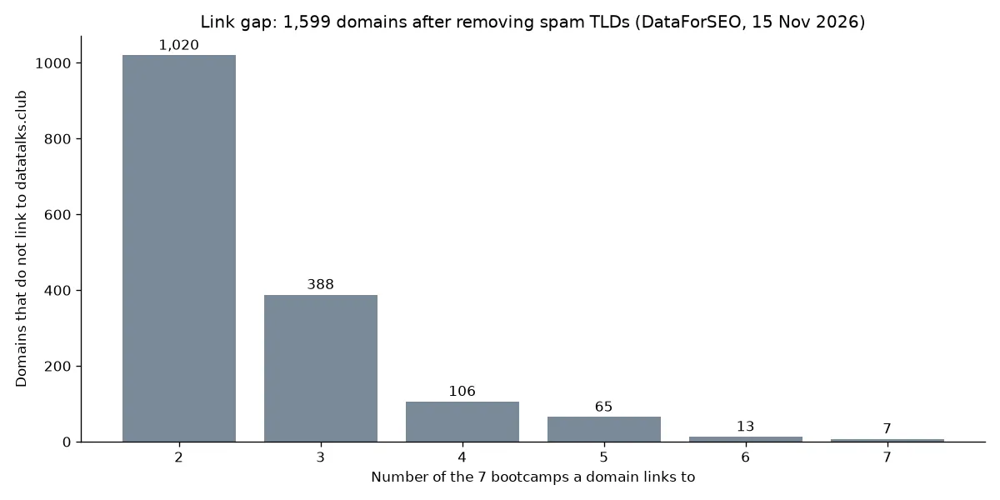

# DataTalksClub Academy: Backlink and Domain Authority Plan

I wrote this plan on 15 November 2026. The question was simple: how do I catch up with Le Wagon, Ironhack and the other bootcamps on domain authority, so the academy pages can rank #1 for the searches that matter by 31 March 2027?

The academy lives in a subfolder, `datatalks.club/academy/`, so every link to any datatalks.club page helps the domain, and links to the academy pages help them most. The end goal is not a number in an SEO tool. It is confirmed signups on the waitlist.

Related pages: [competitor keywords](competitor-keywords.md), [marketing plan](marketing-plan.md), [SEO and AEO best practices](seo-aeo-best-practices.md), [article plan](article-plan.md).

Every number below comes from Moz, DataForSEO, Serpstat or the GitHub API, pulled on 15 November 2026. Every figure marked "estimate" or "target" is mine, not a measurement.

## 1. Summary

- **I will not pass Le Wagon on domain authority by March, and I do not need to.** Le Wagon has 4.5 times my referring root domains in Moz (5,114 against 1,140). But the searches I want are held today by pages on domains with DA 8 to 32. The realistic goal is to pass Turing College (DA 36) and reach DA 37 by 31 March 2027 (target), and to take the academy pages from zero known links to 40 referring domains (target). DA 40 is a target for the second half of 2027.
- **First, keep the links I already have.** The site moves to a new platform on 21 to 24 November. External sites link to old URLs that end in `.html`. Every old URL needs a single 301 to its new address. A broken redirect map loses more links than any outreach can win before April.
- **My biggest link asset points at GitHub, not at my site.** The Data Engineering Zoomcamp repo alone has 284 referring domains and 46,897 stars. None of the main course READMEs links to the academy.
- **The fastest links are small edits to pages that already exist.** Sponsors and tool vendors like Bruin, dltHub, Qdrant, Snowplow, Arize and Evidently already have pages about their work with DataTalksClub. Many past podcast guests list their episode on their own site, but link YouTube instead of the episode page.
- **The link gap is large, but most of it is not worth chasing.** 2,017 domains link to two or more of seven bootcamps and not to datatalks.club. After removing spam, about 50 named targets are left that I can realistically get.
- **Voucher course directories open only after AZAV certification.** KURSNET, mein NOW and DeinBildungsgutschein need the certificate. Before that, bildung.de and editorial pitches are the free options.
- **Three conference deadlines fall in the next five weeks:** FOSDEM (1 December), MLCon Amsterdam (7 December) and PyCon DE (20 December).
- **Wikipedia is not an option now.** There is no article and not enough independent coverage. Press coverage and a data study that people cite come first.

## 2. Where I Stand

<figure>
  
  <figcaption>Domain authority and referring domains for datatalks.club and seven bootcamps, 15 November 2026. Moz and DataForSEO.</figcaption>
</figure>

| Domain | Moz DA | Moz referring root domains | DataForSEO rank (0 to 100) | DataForSEO referring main domains | DataForSEO backlinks |
| --- | --- | --- | --- | --- | --- |
| lewagon.com | 59 | 5,114 | 53 | 3,252 | 25,563 |
| ironhack.com | 58 | 4,476 | 50 | 3,110 | 39,405 |
| careerfoundry.com | 55 | 14,558 | 52 | 8,726 | 35,683 |
| datascientest.com | 48 | 5,075 | 54 | 3,549 | 50,794 |
| turingcollege.com | 36 | 1,365 | 38 | 1,116 | 7,158 |
| **datatalks.club** | **34** | **1,140** | **38** | **823** | **7,126** |
| wbscodingschool.com | 28 | 719 | 47 | 489 | 10,071 |
| spiced-academy.com | 25 | 611 | 34 | 416 | 2,297 |

Moz values come from its latest crawl (1 October to 9 November 2026, per domain). The tools crawl different parts of the web, so the absolute counts differ. The order is nearly the same in all of them, so I track each tool against itself.

What stands out:

- In DataForSEO, datatalks.club and Turing College have the same rank (38).
- A quarter of my referring domains (206 of 823) sit on TLDs like .xyz, .online and .site. These are scraper sites that copy content. Every bootcamp has the same pattern. They do not count as progress.
- Real sites that already link to datatalks.club include github.com, harvard.edu, apple.com, manning.com, jetbrains.com, thenewstack.io, towardsdatascience.com, kdnuggets.com, golem.de, dev.to, qdrant.tech, dlthub.com, evidentlyai.com, airbyte.com, pydata.org and mlops.community.
- The academy pages have no known backlinks yet.

### What DA 40 Needs (Estimate)

Moz Domain Authority is a relative score from 1 to 100. It grows roughly on a log scale, so each point costs more links than the one before. It is also relative: Moz rescales all sites when its index changes, so my DA can drop in a month when I gained links.

Looking at the sites around me:

| Moz DA | Sites | Moz referring root domains |
| --- | --- | --- |
| 32 to 36 | neue fische, datatalks.club, StackFuel, Turing College, Digitale Leute | 807 to 1,365 |
| 38 | GFN | 2,092 |
| 42 to 48 | WBS Training, DataScientest | 4,902 to 5,075 |
| 55 to 61 | CareerFoundry, Ironhack, Le Wagon, Course Report | 4,476 to 14,558 |

Ironhack reaches DA 58 with fewer root domains than DataScientest has at DA 48. Quality matters more than count: Ironhack and Le Wagon get links from TechCrunch, universities and national press.

My estimate: with the current mix of links, DA 40 needs about double the root domains I have now. With strong links from conferences, vendors, press and universities, 300 to 500 new real referring domains over a year should do it, 50 to 80 of them strong. By 31 March 2027, DA 36 to 38 is reachable (estimate).

For rankings that is enough. Google ranks pages, not domains. The academy pages need their own links: 30 to 50 referring domains to `/academy/` pages would put them ahead of most bootcamp course pages I saw in the results (estimate).

## 3. The Link Gap

I asked DataForSEO which domains link to two or more of seven bootcamps (Le Wagon, Ironhack, CareerFoundry, DataScientest, Turing College, Spiced, WBS Coding School) and not to datatalks.club.

| Bootcamps in the check | Domains that link to all of them and not to me |
| --- | --- |
| Le Wagon, Ironhack, CareerFoundry | 415 |
| Le Wagon, Spiced, WBS Coding School (Berlin) | 48 |
| DataScientest, Turing College, CareerFoundry | 111 |
| Any 2 or more of the 7 | 2,017 |

<figure>
  
  <figcaption>Domains that link to bootcamps but not to datatalks.club, by how many of the seven bootcamps they link to. DataForSEO, 15 November 2026.</figcaption>
</figure>

I dropped 403 domains on spam TLDs right away, plus link sellers, SEO directories, coupon sites and paid guest-post blogs. That left 1,599. Most of them are job boards, company databases and large platforms that do not fit. These are the groups that matter:

**Course directories and review sites.** [Course Report](https://www.coursereport.com/list-your-school) links to six of the seven bootcamps. It lists schools that run live programs and publish their tuition, so this one waits until enrollment opens. [SwitchUp](https://switchup.org/schools) has an "Add Your Program" form. Career Karma does not cover Germany. Affiliate "top 10 bootcamps" sites are out.

**Voucher course sites.** genaumeinkurs.de links to all seven bootcamps, kurslotse.de to three. Both compare funded courses, so both wait for AZAV.

**Berlin ecosystem.** [berlin-partner.de](https://www.berlin-partner.de/), invest-in.berlin and why.berlin (all run by Berlin Partner) link to five bootcamps. I can ask through the [ai.berlin directory](https://ai.berlin/ecosystem/directory). [WeAreDevelopers](https://www.wearedevelopers.com/world-congress/call-for-speakers) links to four bootcamps and has a Berlin congress in July 2027.

**German tech media.** t3n.de, computerwoche.de, basicthinking.de, it-daily.net and bigdata-insider.de link to two to four bootcamps each. A data story is the way in (section 6).

**Startup databases.** Crunchbase and Dealroom link to most bootcamps. Free profiles take an hour.

**Podcast directories.** iHeart, iVoox and RedCircle link to several bootcamps. The DataTalksClub podcast is already on Apple, Podchaser, Player FM and Pocket Casts. Claiming the show on the rest is free.

**Developer platforms.** freeCodeCamp links to Le Wagon, Ironhack and CareerFoundry and has a contributor program. Medium links to five bootcamps and not to me.

Things I skip: TechCrunch and The Next Web (funding news), US college ranking sites, employer review sites, job boards, Q&A sites like gutefrage.net (posting my own links there is spam), and IamExpat (listing is paid advertising).

## 4. Relevant Placements Without Competitors

Some places fit the academy even though no bootcamp is there.

### Voucher Course Directories

| Directory | Why | How |
| --- | --- | --- |
| [KURSNET](https://www.arbeitsagentur.de/institutionen/kurse-anbieten) | The catalogue career advisers at the Agentur für Arbeit use | Provider account, then enter each course. Needs the AZAV certificate |
| [mein NOW](https://mein-now.de/weiterbildungssuche/) | Public course search of the Bundesagentur | Fed from KURSNET |
| [DeinBildungsgutschein](https://deinbildungsgutschein.de/fuer-bildungstraeger) | AZAV-only catalogue. ChatGPT cites it for my voucher test question | Register and upload the AZAV certificate |
| [bildung.de](https://www.bildung.de/fuer-anbieter/registrieren) | General education directory with followed links | Free basic entry. No AZAV needed, so this one can go now |

What I prepare now: the KURSNET provider account, the course texts in KURSNET format, and the same facts on [the Bildungsgutschein page](https://datatalks.club/academy/bildungsgutschein/). The goal is both KURSNET listings live within a week of the certificates.

### English Guides for Expats

None of the English expat sites I checked keeps a free list of English voucher courses. They link to KURSNET, or they sell the spot. That is why my own English guide to the Bildungsgutschein is the page most likely to earn links by itself.

- [All About Berlin](https://allaboutberlin.com/glossary/Bildungsgutschein) is the most used English guide to Berlin bureaucracy. It does not take guest posts, but it accepts factual suggestions. A link to a clear English step-by-step guide as a source is a fair ask.
- [ai.berlin](https://ai.berlin/ecosystem/training) lists Berlin AI training. The ask is a listing as a Berlin AI education organization.
- [The Berlin Life](https://theberlinlife.com/bildungsgutschein-in-english/) ranks for "bildungsgutschein in english". A pitch makes sense after AZAV.
- Make it in Germany, Settle in Berlin and Simple Germany have no voucher course lists. I revisit them when the guide is live.

### Awesome Lists on GitHub

Most lists take only free resources, so these are Zoomcamp links. The Zoomcamp pages then point to the academy.

| List | Stars | What to add |
| --- | --- | --- |
| [free-programming-books](https://github.com/EbookFoundation/free-programming-books) | 401,621 | Fix the old ML Zoomcamp URL, add LLM, MLOps and AI Dev Tools Zoomcamps |
| [awesome-claude-code](https://github.com/hesreallyhim/awesome-claude-code) | 58,056 | AI Dev Tools Zoomcamp, through the issue form |
| [Awesome-LLM](https://github.com/Hannibal046/Awesome-LLM) | 27,496 | LLM Zoomcamp under courses |
| [awesome-ai-engineering](https://github.com/dipakkr/awesome-ai-engineering) | 22,572 | Zoomcamps. It also has a bootcamps section |
| [awesome-artificial-intelligence](https://github.com/owainlewis/awesome-artificial-intelligence) | 16,842 | LLM or AI Dev Tools Zoomcamp, with affiliation disclosed |
| [Cookbook](https://github.com/andkret/Cookbook) | 15,550 | Data Engineering Zoomcamp |
| [awesome-generative-ai](https://github.com/steven2358/awesome-generative-ai) | 12,834 | LLM Zoomcamp |
| [awesome-mlops](https://github.com/kelvins/awesome-mlops) | 5,319 | MLOps Zoomcamp |

GitHub links are nofollow, so they do not move DA directly. They bring visitors, AI citations and copies on the many sites that mirror these lists.

### Tool Vendors

| Vendor | Page | Today | Ask |
| --- | --- | --- | --- |
| Bruin | [Zoomcamp page](https://getbruin.com/learn/zoomcamp/) | Links datatalks.club three times | One line about the academy |
| Qdrant | [course post](https://qdrant.tech/blog/datatalks-course/) | Links the GitHub repo only | Add a datatalks.club link |
| dltHub | [events](https://dlthub.com/events) | Links the repo | Link the course page |
| Kestra | [blog](https://kestra.io/blogs/orchestrate-ai-agents-kestra) | Links the LLM Zoomcamp repo | Add the site link |
| Evidently AI | [blog](https://www.evidentlyai.com/blog/ama-alexey-grigorev) | Links datatalks.club | Refresh with the current course pages |
| Anthropic | [Claude ambassadors](https://claude.com/community/ambassadors) | No link | Apply as an individual |
| OpenAI | [Cookbook](https://github.com/openai/openai-cookbook) | No link | A cookbook entry based on an LLM Zoomcamp module, with an author link |
| Hugging Face | huggingface.co/DataTalksClub | No organization page | Create it and set the website |

### Past Podcast Guests

The DataTalksClub podcast has about 194 guests, and most have a website. Episode pages already link to the guest. Some guests already link back from their own "appearances" pages. I found 15 more guests who list their episode on a talks or speaking page but link YouTube or my homepage instead of the episode page. The ask is one line: "here is your episode page, would you link it from your talks page?" The same works for authors from the Book of the Week series. All of this waits until the new site is live, so guests get the final URLs.

### Talks I Gave

My [Sessionize profile](https://sessionize.com/alexey) still shows my old job. Every future call for papers reuses it, so I update it first. Two older interview pages mention DataTalksClub as plain text without a link, and my own site [alexeygrigorev.com](https://alexeygrigorev.com/) should link to the academy.

### Berlin Universities

No Berlin university I checked lists external courses. The realistic option is a guest talk with a link on the event page: [FU Berlin Career Service](https://www.fu-berlin.de/sites/career/unternehmen/index.html) invites organizations to give talks and workshops. CODE University, BHT and the Hertie School Data Science Lab need a personal contact.

### Wikipedia

Not now. There is no article about DataTalksClub or me, and the independent coverage is too thin for Wikipedia's notability rules. Writing an article about myself is a conflict of interest. I look at it again once two or three independent articles exist.

### Blogs and Newsletters

- **dev.to:** already links to me. I create an organization page and cross-post each academy article with the canonical URL set to my blog.
- **Medium:** five bootcamps have links from it, I have none. Same cross-post rule.
- **Newsletters:** [PyCoder's Weekly](https://pycoders.com/submissions) and [Data Engineering Weekly](https://github.com/ananthdurai/dataengineeringweekly) take free submissions. Several AI newsletters only sell slots, so I skip them.
- **Product Hunt and Hacker News:** a waitlist page does not fit. Show HN rules say no landing pages. These make sense only for a free tool (section 6).

## 5. Guest Appearances That Earn a Link

Podcast show notes, author bios and speaker pages link back to the guest. My pitch angles:

1. AI engineering vs agentic engineering, from someone who teaches both.
2. How I run coding agents all day with Claude Code.
3. What teaching more than 100,000 students shows about how developers learn.
4. The Bildungsgutschein in English for developers in Germany.

| # | Place | Type | Why it fits | Angle | How to apply |
| --- | --- | --- | --- | --- | --- |
| 1 | [PyCon DE and PyData 2027](https://pycon.de/call-for-proposals/), Heidelberg, 20 to 22 April | Conference | German Python community, education and AI tracks. Deadline 20 December | 2 or 3 | [Pretalx](https://pretalx.com/pyconde-2027/cfp) |
| 2 | [AI Engineering Podcast](https://www.aiengineeringpodcast.com/) | Podcast | Recent episodes on engineering with AI agents | 1 | [Guest info](https://www.aiengineeringpodcast.com/custompage/guest-info) |
| 3 | [Talk Python To Me](https://talkpython.fm/episodes/all) | Podcast | Recent episodes on AI agents | 2 | Email |
| 4 | [freeCodeCamp](https://www.freecodecamp.org/news/) | Publication | Links three bootcamps, contributor program | 2 | Contributor application |
| 5 | [Practical AI](https://practicalai.show/) | Podcast | Weekly AI show | 1 | Contact |
| 6 | FOSDEM 2027 Educational devroom, Brussels, 30 to 31 January | Conference | Open-source education. The Zoomcamps are open-source courses. Deadline 1 December | 3 | [fosdem.org/submit](https://fosdem.org/submit) |
| 7 | [PyData Berlin meetup](https://www.meetup.com/pydata-berlin/) | Meetup | 9,827 members | 2 | Talk form on the group page |
| 8 | [AI Engineer Europe 2027](https://www.ai.engineer/europe/2027), London, 17 to 19 February | Conference | The AI engineering conference in Europe | 2 | Call for papers on the site |
| 9 | [Vanishing Gradients](https://hugobowne.substack.com/archive) | Podcast | The host was a guest on my podcast | 1 | Direct message |
| 10 | [AI Tinkerers Berlin](https://berlin.aitinkerers.org/) | Meetup | Berlin builders, demo format | 2 | Form on the page |
| 11 | [Towards Data Science](https://towardsdatascience.com/submissions/) | Publication | Already links to me | 1 | Submission form |
| 12 | [The New Stack](https://thenewstack.io/contributions/) | Publication | Already links to me | 1 | Contributor email |
| 13 | [InfoQ](https://www.infoq.com/guidelines/) | Publication | Practitioner articles for senior developers | 2 | Contributor email |
| 14 | [Tech Lead Journal](https://techleadjournal.dev/) | Podcast | Developer careers | 3 | Email |
| 15 | [Software Engineering Radio](https://se-radio.net/) | Podcast | Long-running engineering show | 1 | [Guidelines](https://se-radio.net/about/content-guidelines/) |
| 16 | [MLCon and AI Engineering Summit](https://sessionize.com/devopscon-mlcon-ai-engineering-summit-2027), Amsterdam, 19 to 23 April | Conference | Has an AI engineering track. Deadline 7 December | 1 | Sessionize |
| 17 | [TWIML AI Podcast](https://twimlai.com/podcast/twimlai/) | Podcast | Long-running AI show | 1 | "Recommend a Guest" on the contact page |
| 18 | [programmier.bar](https://www.programmier.bar/podcast) | Podcast | German developer podcast | 2 | Contact page |
| 19 | [WeAreDevelopers World Congress](https://www.wearedevelopers.com/world-congress/call-for-speakers), Berlin, 14 to 16 July | Conference | Links four bootcamps. Call opens soon | 1 | Call for speakers |
| 20 | [The Berlin Life](https://theberlinlife.substack.com/) | Newsletter | The English Berlin outlet that already covers the voucher | 4 | Email |

PyCon DE and MLCon both fall in the first month of the first cohort, and speakers must be on site. I decide on those two with that in mind.

## 6. Testimonials, Case Studies and Sponsors

Many tools I use publish customer stories or community pages that link to the customer. I only consider tools I really use, with a testimonial that describes what I really do with them.

| Vendor | Page | What I use it for |
| --- | --- | --- |
| Evidently AI | [evidentlyai.com](https://www.evidentlyai.com/) | Taught in MLOps Zoomcamp |
| Qdrant | [community](https://qdrant.tech/community/) | LLM Zoomcamp |
| dltHub | [case studies](https://dlthub.com/case-studies) | Data Engineering and LLM Zoomcamps |
| Kestra | [stories](https://kestra.io/stories) | Data Engineering Zoomcamp |
| Hetzner | [customers](https://www.hetzner.com/customers/) | Servers |
| Django | [community blogs](https://www.djangoproject.com/community/blogs/), [Built with Django](https://builtwithdjango.com/projects/) | The new datatalks.club site runs on Django |

Large vendors like Zoom, Slack, GitHub and AWS run customer stories through sales, with no way to submit and no link to the customer. They are low priority.

Course sponsors are the best group. Many already wrote about their work with DataTalksClub:

| Sponsor | Their page today | Ask |
| --- | --- | --- |
| [Bruin](https://getbruin.com/learn/zoomcamp/) | Links datatalks.club | One line about the academy |
| [dltHub](https://dlthub.com/events) | Links the GitHub repo | Link the course page; a short story on teaching dlt to Zoomcamp students |
| [Qdrant](https://qdrant.tech/blog/datatalks-course/) | Links the GitHub repo | Add a datatalks.club link |
| Snowplow | Names DataTalksClub on an event page without a link | Make the mention a link |
| Nebius Academy | No page yet for the joint course | A course page with a link |
| [Kestra](https://kestra.io/stories) | Blog links the repo | A recap of the orchestration module |
| [Arize](https://arize.com/customers/) | Names DataTalksClub on a speaker list without a link | Link the speaker entry |
| Astronomer, Weights & Biases, Prefect, Saturn Cloud, Mage | Workshops or modules in past Zoomcamps | A workshop recap page or a quote from me, linked to the course |

From now on, every sponsor deal includes one page on the sponsor's site (a recap, an event page or a partner entry) that links to the course page on datatalks.club, not only to the GitHub repo.

## 7. The Plan

All link counts are estimates of new real referring domains by 31 March 2027. Nothing goes out before the new site is live and the redirects are checked.

Timeline around the migration: 16 to 20 November, prepare and fix internal links. 21 to 24 November, migration, no outreach. 25 to 27 November, check redirects. From 30 November, outreach with the final URLs. The conference deadlines are the only exception.

### Top 10

| # | Initiative | Problem it solves | New referring domains (estimate) | Effort | Start |
| --- | --- | --- | --- | --- | --- |
| 1 | Migration link protection: 301 every old datatalks.club `.html` URL to its new URL in one hop | External links point to old URLs | 0 new; protects the 823 to 1,140 I have | M | 16 Nov |
| 2 | Internal links to `/academy/` from the homepage, LLM Zoomcamp and AI Dev Tools Zoomcamp pages, podcast pages, relevant blog posts and the course platform | The academy pages get no authority from the rest of the site | 0, but passes existing authority | S | 16 Nov |
| 3 | One line about the academy in the LLM Zoomcamp and AI Dev Tools Zoomcamp READMEs | My most visited pages on GitHub do not mention the academy | 5 to 15 (mirror sites) | S | 25 Nov |
| 4 | Sponsor and vendor page edits: Bruin, dltHub, Qdrant, Snowplow, Arize, Kestra, Evidently, Nebius | Pages about our work together link GitHub or nothing | 5 to 8, strong links | S | 30 Nov |
| 5 | Link asks to the first 40 podcast guests and book authors, plus a standing step after each new episode | Guests link YouTube instead of the episode page | 8 to 15 | M | 30 Nov |
| 6 | Conference talks: FOSDEM (1 Dec), MLCon (7 Dec), PyCon DE (20 Dec), AI Engineer Europe; update my Sessionize bio | Few speaker pages link to me | 2 to 4 | M | 24 Nov |
| 7 | "Bildungsgutschein in English" guide plus a checklist tool, then pitches to All About Berlin, ai.berlin and Berlin expat blogs | No English page explains the voucher for developers | 5 to 12 | M | 14 Dec |
| 8 | Podcast and guest-post pitches, first five | No recent third-party content about the academy topics | 4 to 8 | M | 1 Dec |
| 9 | A data study: how many English AI courses can you pay for with a voucher, counted from KURSNET, with the method and a CSV | Media and AI tools cite numbers, and I have published none | 5 to 15 | L | 12 Jan |
| 10 | Free profiles: bildung.de, Crunchbase, Dealroom, Hugging Face, dev.to, Medium cross-posts, podcast directories | Free profile links I do not have | 6 to 9 | S | 30 Nov |

### Later

- KURSNET, mein NOW and DeinBildungsgutschein listings within a week of the AZAV certificates.
- Course Report, once enrollment is open.
- Awesome list pull requests, one a week.
- One course page per Zoomcamp on datatalks.club, so lists and sponsors link my site instead of GitHub.
- Project showcase pages for Zoomcamp graduates, so students link to my site from their portfolios.
- Berlin ecosystem: Berlin Partner sites, PyData Berlin and AI Tinkerers talks, an FU Berlin career talk.
- A second data study on AI engineering job ads in Germany, pitched to German IT media.
- A third data study on what Zoomcamp graduates build, with the tools named in it.

Top 10 total: about 40 to 85 new real referring domains by 31 March 2027. With the rest: about 85 to 180 (estimates).

## 8. How I Track It

Once a month I pull Moz DA and referring domains for datatalks.club, the academy pages and the seven bootcamps, plus a DataForSEO referring domain list to compare with last month. Once a quarter I repeat the link gap check. I remove spam TLDs before counting.

| KPI | 15 Nov 2026 | Target 31 Jan 2027 | Target 31 Mar 2027 |
| --- | --- | --- | --- |
| Moz DA | 34 | 35 | 37 |
| Moz referring root domains | 1,140 | 1,190 | 1,270 |
| DataForSEO referring main domains, spam removed | 617 | 665 | 750 |
| Referring domains to `/academy/` pages | 0 | 12 | 40 |
| "bildungsgutschein in english" | not ranking | top 3 | #1 |
| "ai bootcamp berlin", "ai bootcamp" | not ranking | top 3 | #1 |
| "ai engineering bootcamp berlin" | not ranking | top 10 | top 3 |
| Confirmed waitlist signups from referral links | 0 | 10 | 35 |

Moz updates slowly, weeks after real changes. DataForSEO shows new links sooner. I judge each month on DataForSEO and each quarter on Moz.

## 9. What I Will Not Do

- Buy links, sponsored posts for the link or "guest post packages". Several domains in the gap sell exactly this.
- Private blog networks or expired domains.
- Link exchanges at scale.
- Spam comments or link drops in forums, Reddit, Stack Overflow or community wikis.
- Mass directory submission.
- AI-generated guest posts. Every guest article comes from my own practice.
- Fake reviews, or testimonials for tools I do not use.
- Wikipedia or similar entries about myself.
- Job-placement promises in any pitch, bio or listing.

## Sources

- Moz Domain Authority and referring root domains: Moz, pulled 15 November 2026, details in [competitor keywords](competitor-keywords.md).
- DataForSEO backlink summaries, referring domain list and domain intersection for the seven bootcamps: 15 November 2026.
- GitHub stars: GitHub API, 15 November 2026.
- Conference deadlines: [PyCon DE](https://pycon.de/call-for-proposals/), [MLCon Amsterdam](https://sessionize.com/devopscon-mlcon-ai-engineering-summit-2027), [FOSDEM mailing list](https://lists.fosdem.org/hyperkitty/list/fosdem@lists.fosdem.org/thread/NGCAWHMUQ3PE7ZTSAM4SRK55GNF6DC2T/), checked 15 November 2026.
